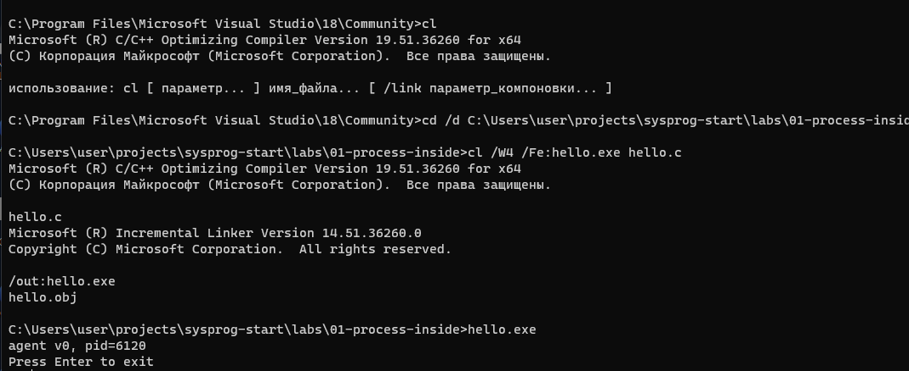
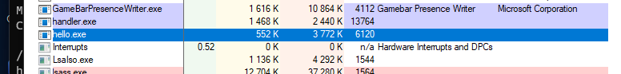
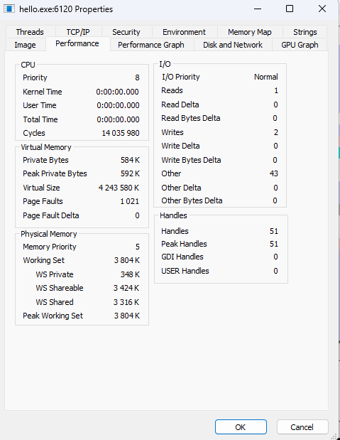
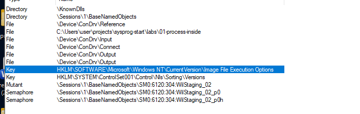
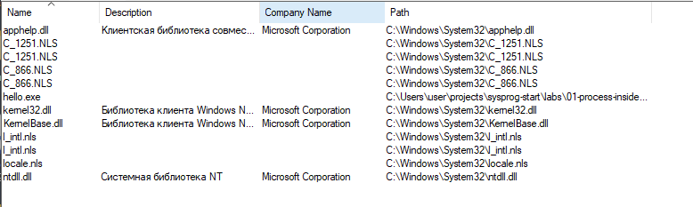
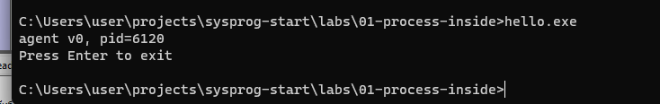
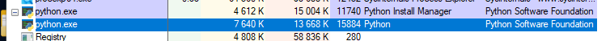
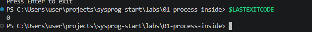

# ЛР 1. Процесс изнутри

Система: **Windows 11 x64 · компилятор: Microsoft C/C++ Optimizing Compiler Version 19.51.36260 for x64**

## Программа на C

Программа напечатала PID **6120, монитор показал PID 6120**.

Память процесса в мониторе: **552 КБ Private Bytes, 3 784 КБ Working Set**. Процессорное время: **00:00:00 (практически нулевое)**.

Пока программа ждёт Enter, процессорное время не растёт, потому что **процесс ожидает ввода с клавиатуры и не выполняет вычисления**.

Дескрипторов у процесса: **точное количество не подсчитывалось**. Ввод и вывод ведут в **консоль Windows через ConDrv (Input и Output)**.

Системные библиотеки в процессе: **ntdll.dll, kernel32.dll, KernelBase.dll, apphelp.dll**.

После завершения из монитора терминал напечатал **ничего, оболочка просто вернула приглашение командной строки**, код завершения **1**.

## Программа на Python

Имя процесса в мониторе: **python.exe, PID 15884**, память: **7 640 КБ Private Bytes, 13 668 КБ Working Set**.

Памяти больше, чем у программы на C, примерно в **13,84 раза (по Private Bytes)**.

Общая библиотека у программ на C и Python: **kernel32.dll, также KernelBase.dll**.

Код завершения при обычном выходе: **0**.

Не получилось: **точное количество дескрипторов процесса C не подсчитывалось.**

## Снимки экрана

Сохраните снимки поверх заглушек в папке `screenshots/` с теми же именами.

### 1. Программа на C запущена

### 2. Свой процесс в мониторе

### 3. Свойства процесса

### 4. Дескрипторы процесса

### 5. Библиотеки процесса

### 6. Процесс завершён из монитора

### 7. Программа на Python в мониторе

### 8. Обычный выход

