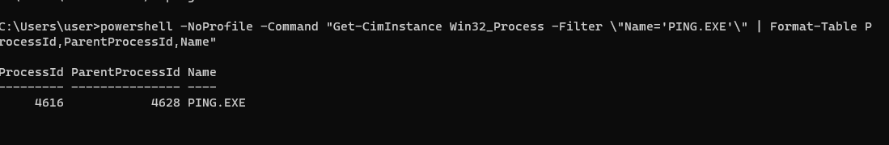
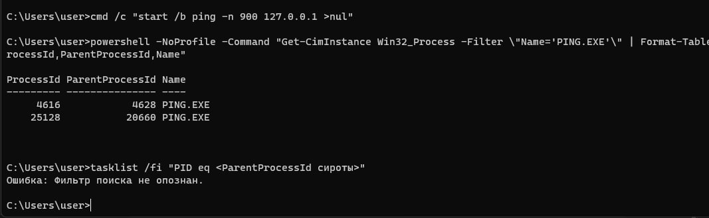

# ЛР 4. Дерево процессов

Система: Windows ___

## Дерево
Процесс в начале дерева и его номер: System Idle Process (0), System (4)
Цепочка родителей терминала (имя и номер): cmd.exe (4628) ← explorer.exe (10060); у cmd.exe есть ребёнок conhost.exe (9596)
Дочерний процесс: номер 4616 (PING.EXE), родитель cmd.exe (4628)
Команда, которой проверен родитель: Get-CimInstance Win32_Process -Filter "Name='PING.EXE'" | Format-Table ProcessId,ParentProcessId,Name. ParentProcessId = 4628, совпал с cmd.exe в дереве.
Процессов у браузера и имя процесса вкладок: 24 дочерних процесса у главного chrome.exe (15904); процесс вкладок называется chrome.exe (тип renderer)

## Сирота
Номер сироты: 25128 (PING.EXE)
Номер родителя до и после завершения настоящего родителя: 20660 и 20660. Windows номер родителя не меняет, процесса 20660 уже нет (tasklist ответил, что задач нет).
Где сирота стоит в дереве: у левого края, на верхнем уровне. Process Explorer не находит родителя по номеру 20660 и ставит процесс в корень, как и explorer.exe.

Не получилось: всё получилось

## Снимки экрана

