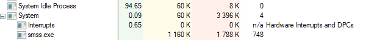
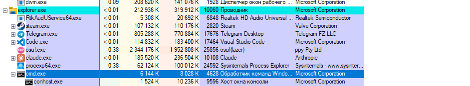
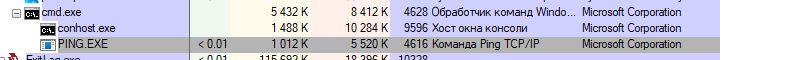
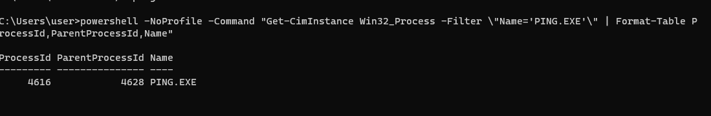
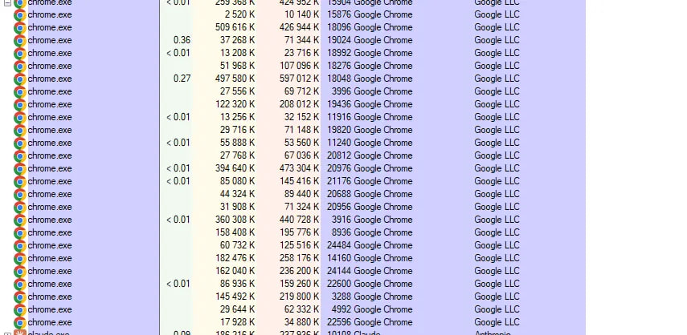
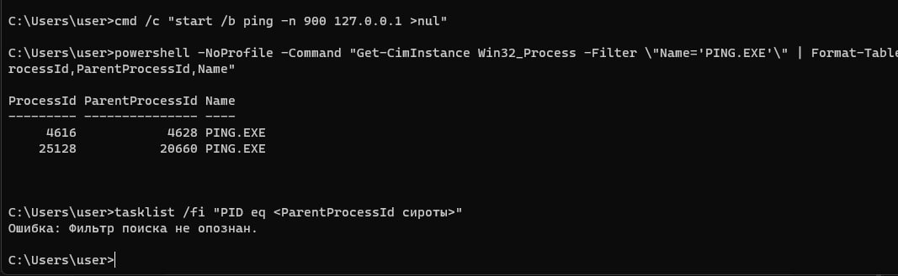

# ЛР 4. Дерево процессов

Система: **Windows 11 Pro 25H2 · x64 (AMD)**

## Дерево

Процесс в начале дерева и его номер: **требуется уточнить по снимку дерева**

Цепочка родителей терминала (имя и номер): **cmd.exe (PID 3104) → python.exe (PID 21648) → python.exe (PID 21588)**

Дочерний процесс: **hostname.exe (PID 9764)**, родитель **python.exe (PID 21588)**.

Команда, которой проверен родитель: **`python -c "import subprocess; subprocess.run(['hostname.exe'])"`**

## Снимки экрана

Сохраните снимок поверх заглушки в папке `screenshots/` с тем же именем — ссылки ниже менять не нужно.

### 1. Начало дерева процессов
Шаг 1. Видно: дерево процессов в мониторе: первые процессы системы и их номера.

### 2. Терминал и его родители
Шаг 2. Видно: ветка дерева от процесса терминала вверх до процесса системы.

### 3. Дочерний процесс терминала
Шаг 3. Видно: запущенный из терминала процесс под оболочкой терминала.

### 4. Родитель по команде
Шаг 4. Видно: вывод команды с номером процесса и номером его родителя.

### 5. Процессы браузера
Шаг 5. Видно: раскрытая ветка браузера с дочерними процессами.

### 6. Процесс без родителя
Шаг 6. Видно: команда запуска и номер родителя у оставшегося процесса.

### 7. Сирота в дереве
Шаг 7. Видно: тот же процесс в дереве монитора на новом месте.

