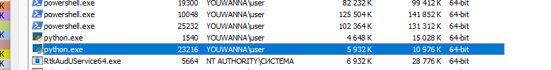
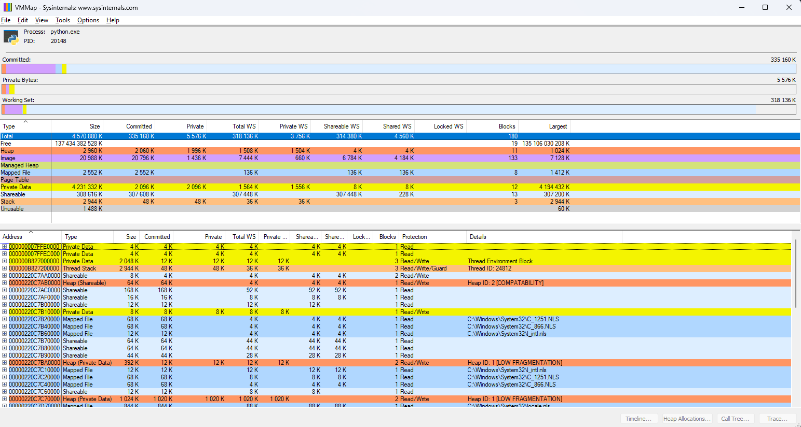
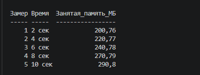

# ЛР 8. Карта памяти

**Система:** Windows 11 Pro, версия 25H2, 64-разрядная (x64).

**Чем мерил (виртуальная и занятая):** PowerShell (`Get-Process`) и программа Sysinternals VMMap. Для виртуальной памяти использовался показатель `VirtualMemorySize64`, для занятой — `WorkingSet64`.

## Этапы mem.py

Измерения проводились на разных этапах выполнения программы `mem.py`.

| Этап | Виртуальная память | Занятая память |
|---|---:|---:|
| Старт | 4170,92 МБ | 10,73 МБ |
| Получил 300 МБ | 4462,30 МБ | 10,68 МБ |
| Записал в каждую страницу | 4462,30 МБ | 310,68 МБ |
| Освободил | 4162,30 МБ | 10,69 МБ |

**Почему занятая память выросла только на третьем этапе:**

На втором этапе программа выделила область виртуальной памяти размером 300 МБ, но ещё не записывала в неё данные. Поэтому виртуальная память увеличилась, а физическая занятая память практически не изменилась.

На третьем этапе программа записала значение в каждую страницу выделенной области. Операционная система начала выделять физическую память для хранения этих данных, поэтому показатель занятой памяти увеличился примерно на 300 МБ.

На четвёртом этапе программа вызвала `data.close()`, освободив выделенную область памяти. Занятая память вернулась примерно к начальному значению.

## Карта памяти

Карта памяти процесса состоит из нескольких основных частей:

- **Image** — память, в которой размещён исполняемый файл программы и её библиотеки.
- **Mapped File** — области памяти, связанные с отображёнными файлами.
- **Private Data** — частная память процесса.
- **Heap** — динамически выделяемая память.
- **Stack** — стек, используемый для хранения локальных переменных и данных вызовов функций.
- **Free** — свободные области виртуального адресного пространства.

VMMap позволяет увидеть распределение памяти процесса по этим категориям и сравнить изменения на разных этапах выполнения программы.

## Утечка

Для проверки утечки памяти использовалась программа `leak.py`. Она каждую секунду выделяет 10 МБ памяти и сохраняет выделенные блоки в списке, не освобождая их.

**Пять замеров leak.py:**

| Замер | Время | Занятая память |
|---|---:|---:|
| 1 | 2 сек | 200,76 МБ |
| 2 | 4 сек | 220,77 МБ |
| 3 | 6 сек | 240,78 МБ |
| 4 | 8 сек | 270,79 МБ |
| 5 | 10 сек | 290,80 МБ |

**На сколько росла память за 2 секунды:**

- С 2 до 4 секунд — 20,01 МБ.
- С 4 до 6 секунд — 20,01 МБ.
- С 6 до 8 секунд — 30,01 МБ.
- С 8 до 10 секунд — 20,01 МБ.

Общий рост занятой памяти между первым и последним замерами составил 90,04 МБ за 8 секунд.

Это показывает постепенное увеличение потребления памяти программой. Причина заключается в том, что программа сохраняет выделенные блоки в списке `kept`, поэтому они продолжают занимать память.

**Не получилось:** сначала возникли трудности с определением правильного PID процесса и синхронизацией замеров с этапами выполнения программы. После повторных запусков удалось получить необходимые измерения и снимки экрана.

## Снимки экрана

### 1. Карта памяти

Шаг 2. Карта памяти процесса `mem.py` на старте и её итог.

### 2. Получено 300 МБ

Шаг 3. Виртуальная память выросла после выделения 300 МБ, занятая память практически не изменилась.

### 3. Страницы заняты

Шаг 4. Занятая память после записи в каждую страницу.

### 4. Утечка

Шаг 6. Пять замеров роста занятой памяти программы `leak.py`.

